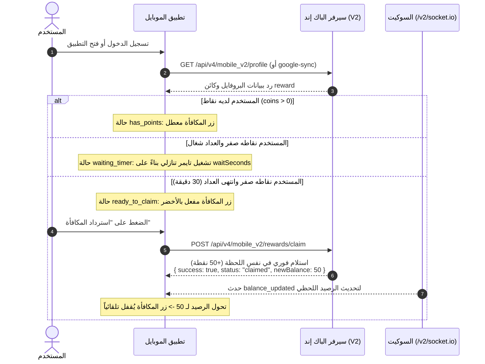

# دليل مطور الموبايل: نظام المستخدمين، المكافأة اليومية (Zero-Balance Instant Claim)، والأرصدة (V2)

هذا المستند مخصص لمطور تطبيق الموبايل كدليل رسمي شامل ومحدث يوضح بالتفصيل كيفية التعامل مع **بيانات المستخدمين، تسجيل الدخول بجوجل، نظام النقاط، وآلية استرداد المكافأة اليومية بعد استنفاد النقاط** بعد نقل كامل البيانات إلى قاعدة بيانات السيرفر (MongoDB).

---

## 1. الدومين المعتمد للـ APIs والسوكيت (Important Base URLs)

> [!IMPORTANT]
> الدومين المعتمد والشغال حالياً على السيرفر لجميع خدمات الـ APIs وخادم الـ Socket هو:
> ### `https://dashboard.flycompany.online`
> 
> السيرفر (عبر Caddy Reverse Proxy) يقوم بتوجيه المسارات تلقائياً:
> * أي مسار يبدأ بـ `/api/...` يتم توجيهه تلقائياً لمحرك الـ API (Node.js Express).
> * أي مسار يبدأ بـ `/v2/socket.io` يتم توجيهه تلقائياً لمحرك الـ Socket.io.
> * الصفحة الرئيسية بدون مسار تفتح لوحة تحكم الويب.

* **الرابط الأساسي لخدمات الموبايل (Base API URL):**
  `https://dashboard.flycompany.online/api/v4/mobile_v2`
* **رابط اتصال السوكيت (Socket.io URL):**
  `https://dashboard.flycompany.online` (مع تحديد المسار: `/v2/socket.io`)

---

## 2. آلية وقواعد استرداد المكافأة اليومية (Reward Business Rules)

بناءً على متطلبات التطبيق الفعلية:
1. **شرط تصفير النقاط (Zero-Balance Requirement):** لا يمكن للمستخدم استرداد المكافأة (`Claim Reward`) طالما لديه نقاط سابقة في رصيده (`coins > 0`). يجب أن يستنفد نقاطه أولاً.
2. **بدء الجدولة التلقائي (Automatic 30-Min Countdown):** عند تنفيذ المستخدم لأوردر وتصبح نقاطه الحالية صفرًا (`coins == 0`)، يبدأ العداد التنازلي لنزول النقاط الجديدة تلقائيًا (الافتراضي: 30 دقيقة، محددة من الإدارة).
3. **الاسترداد اليدوي واللحظي (Instant Claim on Click):** النقاط **لا تنزل تلقائياً في رصيد المستخدم**، بل يجب على المستخدم الضغط على زر "استرداد المكافأة" في التطبيق. وعند الضغط بعد انتهاء العداد، تنزل النقاط **فوراً في نفس اللحظة** بدون أي انتظار إضافي.
4. **تكرار العملية:** الضغط على زر الاسترداد لا يجدول وقت الاستلام التالي، بل يتم بدء الجدولة الجديدة تلقائياً فقط عندما يعود رصيد المستخدم إلى صفر مرة أخرى.

---

## 3. دورة حياة المستخدم والمكافأة (Lifecycle Flow)



---

## 4. تفاصيل الواجهات البرمجية (REST API Endpoints)

### أولاً: تسجيل الدخول والمزامنة (Google Auth Sync)
يتم استدعاء هذا الـ API **مباشرة بعد نجاح تسجيل الدخول بجوجل** في التطبيق، سواء كان المستخدم جديداً أو قديماً.

* **المسار:** `POST /api/v4/mobile_v2/auth/google-sync`
* **الرابط الكامل:** `https://dashboard.flycompany.online/api/v4/mobile_v2/auth/google-sync`
* **المتطلبات (Body):**
```json
{
  "uid": "FIREBASE_UID_HERE",
  "email": "user@gmail.com",
  "name": "Ahmed Ali",
  "photo": "https://lh3.googleusercontent.com/...",
  "fcm": "FCM_TOKEN_HERE"
}
```

* **الاستجابة الناجحة (HTTP 200 OK):**
```json
{
  "success": true,
  "message": "User authenticated and synchronized successfully",
  "user": {
    "uid": "FIREBASE_UID_HERE",
    "email": "user@gmail.com",
    "name": "Ahmed Ali",
    "photo": "https://lh3.googleusercontent.com/...",
    "coins": 0,
    "dollars": 0,
    "pointsPerDollar": 100,
    "dollarsToPointsValue": 0,
    "dailyRewards": 50,
    "isVip": false,
    "banned": false,

    "reward": {
      "status": "waiting_timer",
      "canClaim": false,
      "rewardAmount": 50,
      "waitSeconds": 1420,
      "eligibleAt": "2026-10-22T19:00:00.000Z",
      "message": "متبقي 24 دقيقة لاسترداد المكافأة"
    },

    "canClaimReward": false,
    "cooldownSeconds": 1420,
    "activePromotion": null,
    "upcomingPromotion": {
      "title": "Happy Hour",
      "startAt": "2026-10-25T16:00:00.000Z",
      "endAt": "2026-10-25T17:00:00.000Z",
      "rewardAmount": 100
    }
  }
}
```

> [!TIP]
> **التعامل مع البروموشن في تطبيق الموبايل:**
> 1. عند وجود `upcomingPromotion`: يعرض التطبيق شريط تنبيهي للمستخدم يخبره بالعرض القادم وموعده (مثلاً: "عرض قادم الساعة 6:00 مساءً بمكافأة 100 نقطة").
> 2. عند دخول وقت العرض، يتحول تلقائياً إلى `activePromotion` وتصبح قيمة المكافأة `rewardAmount` مضاعفة فورياً بدون الحاجة لأي تعديل من التطبيق.


---

### ثانياً: جلب البروفايل والرصيد وحالة المكافأة (Get User Profile)
يُستدعى عند فتح التطبيق في المرات اللاحقة لعرض بيانات المستخدم وتحديث التايمر.

* **المسار:** `GET /api/v4/mobile_v2/profile`
* **الرابط الكامل:** `https://dashboard.flycompany.online/api/v4/mobile_v2/profile?uid=FIREBASE_UID_HERE`
* **طرق التمرير:** عبر Query `?uid=...` أو Header `x-user-uid: ...`

#### شرح حالات كائن `reward` داخل البروفايل:

1. **الحالة الأولى (`status: "has_points"`):**
   المستخدم لديه رصيد نقاط (`coins > 0`).
   ```json
   "reward": {
     "status": "has_points",
     "canClaim": false,
     "rewardAmount": 50,
     "waitSeconds": 0,
     "eligibleAt": null,
     "message": "لديك نقاط متبقية، يجب استنفاد نقاطك أولاً لتفعيل المكافأة"
   }
   ```
   *سلوك التطبيق:* زر المكافأة معطل أو مخفي. لا يوجد عداد.

2. **الحالة الثانية (`status: "waiting_timer"`):**
   المستخدم نقاطه صفر (`coins == 0`) والعداد التنازلي للـ 30 دقيقة شغال.
   ```json
   "reward": {
     "status": "waiting_timer",
     "canClaim": false,
     "rewardAmount": 50,
     "waitSeconds": 1200,
     "eligibleAt": "2026-10-22T19:00:00.000Z",
     "message": "متبقي 20 دقيقة لاسترداد المكافأة"
   }
   ```
   *سلوك التطبيق:* شغّل تايمر تنازلي على الشاشة بالثواني المتبقية `waitSeconds`.

3. **الحالة الثالثة (`status: "ready_to_claim"`):**
   المستخدم نقاطه صفر وانتهت فترة الـ 30 دقيقة. المكافأة جاهزة الآن!
   ```json
   "reward": {
     "status": "ready_to_claim",
     "canClaim": true,
     "rewardAmount": 50,
     "waitSeconds": 0,
     "eligibleAt": "2026-10-22T18:30:00.000Z",
     "message": "المكافأة جاهزة للاسترداد الآن!"
   }
   ```
   *سلوك التطبيق:* أظهر زر "استرداد المكافأة" مفعلاً باللون الأخضر (`canClaim: true`).

---

### ثالثاً: طلب استرداد المكافأة (Claim Reward API)
يُستدعى عندما يضغط المستخدم على زر "استرداد المكافأة".

* **المسار:** `POST /api/v4/mobile_v2/rewards/claim`
* **الرابط الكامل:** `https://dashboard.flycompany.online/api/v4/mobile_v2/rewards/claim`
* **المتطلبات (Body):**
```json
{
  "uid": "FIREBASE_UID_HERE"
}
```

* **الاستجابة الناجحة الفورية (HTTP 200 OK):**
  النقاط تُضاف فوراً في نفس اللحظة إلى محفظة المستخدم:
```json
{
  "success": true,
  "status": "claimed",
  "canClaim": false,
  "amount": 50,
  "newBalance": 50,
  "coins": 50,
  "dollars": 50,
  "message": "تم استرداد 50 نقطة بنجاح إلى رصيدك!"
}
```

* **في حال حاول المستخدم الاسترداد ولديه نقاط متبقية (`coins > 0`):**
```json
{
  "success": false,
  "status": "has_points",
  "canClaim": false,
  "currentCoins": 25,
  "message": "لا يمكنك استرداد المكافأة طالما لديك نقاط متبقية، يجب استنفاد نقاطك أولاً"
}
```

* **في حال حاول المستخدم الاسترداد قبل انتهاء فترة العداد التنازلي:**
```json
{
  "success": false,
  "status": "waiting_timer",
  "canClaim": false,
  "amount": 50,
  "waitSeconds": 850,
  "eligibleAt": "2026-10-22T19:00:00.000Z",
  "message": "يرجى انتظار انتهاء فترة العداد التنازلي (15 دقيقة)"
}
```

---

### رابعاً: إنشاء طلب/أوردر وتصفير النقاط تلقائياً (Create Order)
عند إنشاء طلب جديد عبر `POST /api/v4/mobile_v2/create`:
* السيرفر يخصم تلقائياً تكلفة التفاعل `maxCount` (أو `cost` / `points`) من رصيد المستخدم.
* **بمجرد أن يصبح رصيد المستخدم صفر (`coins <= 0`):**
  السيرفر يقوم أوتوماتيكياً ببدء عداد الـ 30 دقيقة للمكافأة القادمة.

---

### خامساً: فك وتحويل الدولارات إلى نقاط (Dollars to Points Exchange)

يستطيع المستخدم في أي وقت فك رصيده من الدولارات وتحويلها فورياً إلى نقاط تضاف لمحفظته.

* **المسار:** `POST /api/v4/mobile_v2/exchange-dollars`
* **المتطلبات (Body):**
```json
{
  "uid": "FIREBASE_UID_HERE",
  "amount": 5 // اختياري: عدد الدولارات المراد فكها، أو "all" أو حذف الحقل لفك كامل رصيد الدولارات
}
```

* **الاستجابة:**
```json
{
  "success": true,
  "message": "تم فك 5$ بنجاح والحصول على 500 نقطة!",
  "exchange": {
    "dollarsExchanged": 5,
    "pointsAwarded": 500,
    "pointsPerDollar": 100,
    "remainingDollars": 0,
    "totalCoins": 500
  }
}
```

---

## 5. استقبال تحديث الرصيد لحظياً عبر السوكيت (Socket.io)

عند اتصالك بالسوكيت:
* **الرابط:** `https://dashboard.flycompany.online`
* **المسار (Path):** `/v2/socket.io`
* **المصادقة:** مرر الـ `uid` في كائن `auth`:
  ```javascript
  auth: { uid: "FIREBASE_UID_HERE" }
  ```

### الاستماع لحدث تحديث الرصيد:
بمجرد استرداد المكافأة أو فك دولارات، يرسل السيرفر تلقائياً حدث `balance_updated`:
```javascript
socket.on("balance_updated", (data) => {
  console.log("تم تحديث الرصيد:", data.newBalance);
  // data: { uid: "...", newBalance: 50, added: 50, reason: "daily_reward" }
});
```

---

## 6. كود استدعاء كامل ومحدث (Flutter / Dart)

```dart
import 'dart:convert';
import 'package:http/http.dart' as http;
import 'package:firebase_auth/firebase_auth.dart';
import 'package:firebase_messaging/firebase_messaging.dart';
import 'package:socket_io_client/socket_io_client.dart' as IO;

class ApiService {
  static const String baseUrl = 'https://dashboard.flycompany.online/api/v4/mobile_v2';
  static const String socketUrl = 'https://dashboard.flycompany.online';

  // 1. مزامنة المستخدم بعد تسجيل الدخول بجوجل
  static Future<Map<String, dynamic>?> syncGoogleUser(User user) async {
    String? fcmToken = await FirebaseMessaging.instance.getToken();

    final response = await http.post(
      Uri.parse('$baseUrl/auth/google-sync'),
      headers: {'Content-Type': 'application/json'},
      body: jsonEncode({
        'uid': user.uid,
        'email': user.email ?? '',
        'name': user.displayName ?? '',
        'photo': user.photoURL ?? '',
        'fcm': fcmToken ?? '',
      }),
    );

    if (response.statusCode == 200) {
      final data = jsonDecode(response.body);
      return data['user'];
    }
    return null;
  }

  // 2. جلب البروفايل وحالة المكافأة
  static Future<Map<String, dynamic>?> getProfile(String uid) async {
    final response = await http.get(
      Uri.parse('$baseUrl/profile?uid=$uid'),
      headers: {'Content-Type': 'application/json'},
    );

    if (response.statusCode == 200) {
      final data = jsonDecode(response.body);
      return data['user'];
    }
    return null;
  }

  // 3. طلب استرداد المكافأة اللحظي
  static Future<Map<String, dynamic>> claimReward(String uid) async {
    final response = await http.post(
      Uri.parse('$baseUrl/rewards/claim'),
      headers: {'Content-Type': 'application/json'},
      body: jsonEncode({'uid': uid}),
    );

    return jsonDecode(response.body);
  }

  // 4. الاتصال بالسوكيت وتحديث الرصيد اللحظي
  static IO.Socket initSocket(String uid, Function(int newBalance) onBalanceUpdated) {
    IO.Socket socket = IO.io(socketUrl, IO.OptionBuilder()
        .setTransports(['websocket'])
        .setPath('/v2/socket.io')
        .setAuth({'uid': uid})
        .setReconnectionDelay(1000)
        .build());

    socket.onConnect((_) {
      print('Connected to Socket.io');
    });

    socket.on('balance_updated', (data) {
      int newBalance = data['newBalance'];
      onBalanceUpdated(newBalance);
    });

    return socket;
  }
}
```
