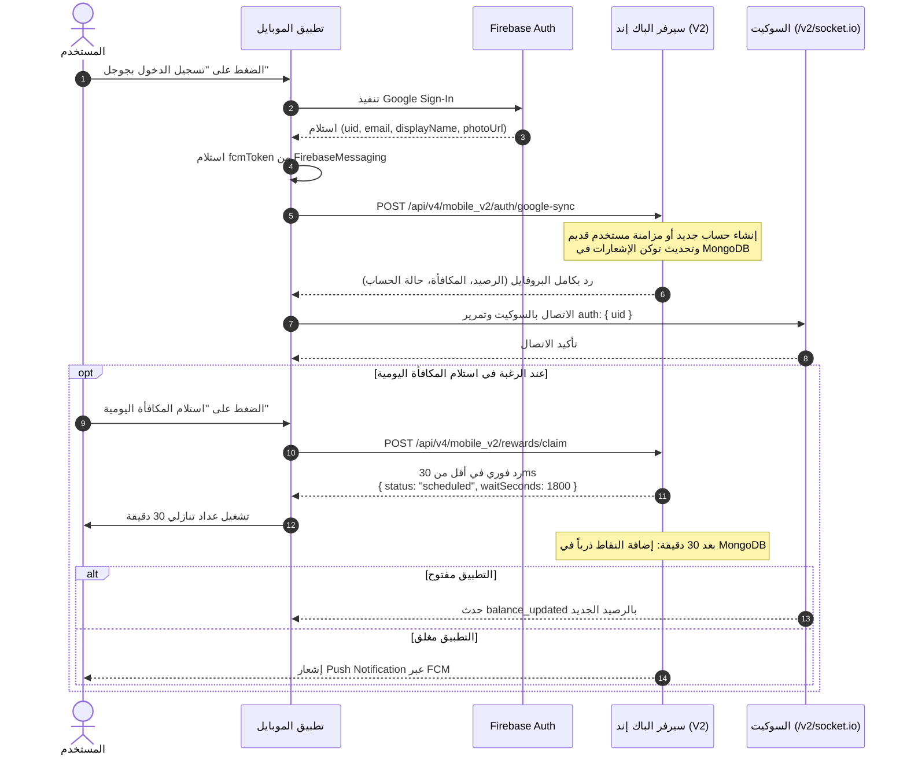

# دليل مطور الموبايل: نظام المستخدمين، تسجيل الدخول بجوجل، والمكافآت اليومية (V2)

هذا المستند مخصص لمطور تطبيق الموبايل كدليل منفصل يوضح بالتفصيل كيفية التعامل مع **بيانات المستخدمين، تسجيل الدخول بجوجل، ونظام النقاط والمكافآت اليومية** بعد إلغاء الاعتماد على Firebase Firestore ونقل كامل البيانات لقاعدة بيانات السيرفر (MongoDB).

---

## 1. الدومين المعتمد للـ APIs والسوكيت (Important Base URLs)

> [!IMPORTANT]
> الدومين المعتمد والشغال حالياً على السيرفر لجميع خدمات الـ APIs وخادم الـ Socket هو:
> ### `https://dashboard.flycompany.online`
> 
> **كيف يعمل السيرفر؟**
> السيرفر (عبر Caddy Reverse Proxy) يقوم بتوجيه المسارات تلقائياً:
> * أي مسار يبدأ بـ `/api/...` يتم توجيهه تلقائياً لمحرك الـ API (Node.js Express).
> * أي مسار يبدأ بـ `/v2/socket.io` يتم توجيهه تلقائياً لمحرك الـ Socket.io.
> * الصفحة الرئيسية بدون مسار تفتح لوحة تحكم الويب.

* **الرابط الأساسي لخدمات الموبايل (Base API URL):**
  `https://dashboard.flycompany.online/api/v4/mobile_v2`
* **رابط اتصال السوكيت (Socket.io URL):**
  `https://dashboard.flycompany.online` (مع تحديد المسار: `/v2/socket.io`)

---

## 2. دور Firebase بعد التحديث (Scope of Firebase)

تطبيق الموبايل **لن يتعامل مع Firestore نهائياً** (لا قراءة ولا كتابة). دور Firebase ينحصر حصرياً في نقطتين:
1. **تسجيل الدخول بجوجل (Firebase Authentication):** للمصادقة والحصول على الـ `uid` والبريد الإلكتروني والاسم والصورة.
2. **خدمة الإشعارات (Firebase Cloud Messaging - FCM):** لاستقبال إشعارات وصول المكافأة أو التنبيهات على الهاتف.

---

## 3. السيناريو الكامل خطوة بخطوة (Full Mobile Lifecycle)



---

## 4. تفاصيل الواجهات البرمجية (REST API Endpoints)

### أولاً: تسجيل الدخول والمزامنة (Google Auth Sync)
يتم استدعاء هذا الـ API **مباشرة بعد نجاح تسجيل الدخول بجوجل** في التطبيق، سواء كان المستخدم جديداً أو قديماً.

* **المسار:** `POST /api/v4/mobile_v2/auth/google-sync`
* **الرابط الكامل:** `https://dashboard.flycompany.online/api/v4/mobile_v2/auth/google-sync`
* **المتطلبات (Body):**
```json
{
  "uid": "FIREBASE_UID_HERE",
  "email": "user@gmail.com",
  "name": "Ahmed Ali",
  "photo": "https://lh3.googleusercontent.com/...",
  "fcm": "FCM_TOKEN_HERE"
}
```

* **ما يفعله السيرفر:**
  * **إذا كان المستخدم جديداً يسجل لأول مرة:** يتم إنشاء حسابه في MongoDB ويمنحه السيرفر فورياً رصيد نقاط مبدئي مساوياً لقيمة `globalDailyReward` المحددة في الإعدادات (افتراضياً 50 نقطة)، ورصيد دولارات 0$.
  * **إذا كان مستخدماً قديماً أو حالياً:** يقوم السيرفر بتحديث توكن الإشعارات `fcm` ووقت آخر ظهور `lastSignIn` وإرجاع رصيده المحدث.

* **الاستجابة الناجحة (HTTP 200 OK):**
```json
{
  "success": true,
  "message": "User authenticated and synchronized successfully",
  "user": {
    "uid": "FIREBASE_UID_HERE",
    "email": "user@gmail.com",
    "name": "Ahmed Ali",
    "photo": "https://lh3.googleusercontent.com/...",
    "coins": 500,
    "dollars": 5,
    "pointsPerDollar": 100,
    "dollarsToPointsValue": 500,
    "dailyRewards": 50,
    "isVip": false,
    "banned": false,
    "canClaimReward": true,
    "cooldownSeconds": 0,
    "pendingReward": null,
    "activePromotion": {
      "active": true,
      "amount": 100
    }
  }
}
```
* **توضيح الحقول الجديدة الخاصة بالأرصدة والتحويل:**
  * `coins`: رصيد النقاط الفعلي للمستخدم في حسابه.
  * `dollars`: رصيد الدولارات للمستخدم (يمكن تحويله وفكه إلى نقاط في أي وقت).
  * `pointsPerDollar`: معدل تحويل الدولار إلى نقاط المحدد من الإدارة (مثلاً `100`، أي كل 1$ = 100 نقطة).
  * `dollarsToPointsValue`: إجمالي النقاط المتوقع الحصول عليها إذا قام المستخدم بفك كامل رصيد دولاراته الحالي (`dollars * pointsPerDollar`).
  * `dailyRewards`: قيمة نقاط المكافأة اليومية **موحدة لجميع المستخدمين** ومحددة مركزياً من لوحة التحكم، وتتضاعف تلقائياً إذا كان هناك عرض ترويجي نشط (`activePromotion`).

---

### ثانياً: جلب البروفايل والرصيد (Get User Profile)
يُستدعى عند فتح التطبيق في المرات اللاحقة (إذا كان المستخدم مسجل دخوله بالفعل ولديه جلسة محفوظة في الهاتف).

* **المسار:** `GET /api/v4/mobile_v2/profile`
* **الرابط الكامل:** `https://dashboard.flycompany.online/api/v4/mobile_v2/profile?uid=FIREBASE_UID_HERE`
* **طرق التمرير المتاحة:**
  * عبر الـ Query: `?uid=FIREBASE_UID`
  * أو عبر الـ Header: `x-user-uid: FIREBASE_UID`

* **الاستجابة:** ترجع نفس كائن `user` الموضح أعلاه.
  * إذا كانت `canClaimReward: true` فهذا يعني أن زر المكافأة متاح للضغط.
  * إذا كان هناك طلب مكافأة معلق، سترجع `pendingReward` بهذا الشكل لتشغيل العداد التنازلي في الواجهة:
    ```json
    "pendingReward": {
      "id": "67...",
      "amount": 50,
      "waitSeconds": 1420,
      "executeAt": "2026-10-17T16:30:00.000Z"
    }
    ```

---

### ثالثاً: طلب استلام المكافأة اليومية (Claim Daily Reward)
عندما يضغط المستخدم على زر "استلام المكافأة اليومية".

* **المسار:** `POST /api/v4/mobile_v2/rewards/claim`
* **الرابط الكامل:** `https://dashboard.flycompany.online/api/v4/mobile_v2/rewards/claim`
* **المتطلبات (Body):**
```json
{
  "uid": "FIREBASE_UID_HERE"
}
```

* **الرد الفوري وغير المعطل (Non-blocking):**
  السيرفر يرد في أقل من **30 ملي ثانية**:
```json
{
  "success": true,
  "status": "scheduled",
  "amount": 50,
  "waitSeconds": 1800,
  "executeAt": "2026-10-17T16:30:00.000Z",
  "message": "تم جدولة إضافة المكافأة بنجاح"
}
```

* **المطلوب من تطبيق الموبايل:**
  1. أظهر رسالة للمستخدم: "تم جدولة مكافأتك بنجاح، ستصلك بعد 30 دقيقة".
  2. شغّل عداداً تنازلياً يعتمد على `waitSeconds`.
  3. **لا تقم بعمل Poll أو إرسال طلبات متكررة للسيرفر**؛ السيرفر سيتولى إضافة النقاط وإخطارك تلقائياً فور انتهائها.

* **في حال كان المستخدم في فترة الانتظار (24 ساعة Cooldown):**
  السيرفر سيرد بـ:
```json
{
  "success": false,
  "onCooldown": true,
  "status": "cooldown",
  "waitSeconds": 65400,
  "message": "تم استلام المكافأة اليومية بالفعل، يرجى الانتظار للمرة القادمة"
}
```

---

### رابعاً: تحديث توكن الإشعارات (Update FCM Token)
إذا قام نظام أندرويد/آيفون بتحديث الـ FCM Token أثناء عمل التطبيق (Token Refresh):

* **المسار:** `POST /api/v4/mobile_v2/fcm-token`
* **الرابط الكامل:** `https://dashboard.flycompany.online/api/v4/mobile_v2/fcm-token`
* **المتطلبات (Body):**
```json
{
  "uid": "FIREBASE_UID_HERE",
  "fcm": "NEW_FCM_TOKEN_HERE"
}
```

---

### خامساً: فك وتحويل الدولارات إلى نقاط (Dollars to Points Exchange)

يستطيع المستخدم في أي وقت فك رصيده من الدولارات وتحويلها فورياً إلى نقاط تضاف لمحفظته.

#### 1. استعلام عن سعر صرف الدولار مقابل النقاط:
* **المسار:** `GET /api/v4/mobile_v2/exchange-rate`
* **الاستجابة:**
```json
{
  "success": true,
  "pointsPerDollar": 100,
  "description": "كل 1 دولار يعادل 100 نقطة"
}
```

#### 2. إرسال طلب فك الدولار (Exchange Request):
* **المسار:** `POST /api/v4/mobile_v2/exchange-dollars`
* **الرابط الكامل:** `https://dashboard.flycompany.online/api/v4/mobile_v2/exchange-dollars`
* **المتطلبات (Body):**
```json
{
  "uid": "FIREBASE_UID_HERE",
  "amount": 5 // اختياري: عدد الدولارات المراد فكها، أو "all" أو حذف الحقل لفك كامل رصيد الدولارات
}
```

* **الاستجابة الناجحة (HTTP 200 OK):**
```json
{
  "success": true,
  "message": "تم فك 5$ بنجاح والحصول على 500 نقطة!",
  "exchange": {
    "dollarsExchanged": 5,
    "pointsAwarded": 500,
    "pointsPerDollar": 100,
    "remainingDollars": 0,
    "totalCoins": 1000
  }
}
```

---

### سادساً: استقبال الإشعارات العامة لجميع المستخدمين (Broadcast Push Notifications)

يقوم الأدمن من لوحة التحكم بإرسال إشعارات عامة لجميع المستخدمين. لضمان استقبال المستخدم لجميع الإشعارات العامة حتى لو لم يكن التطبيق مفتوحاً:

1. **الاشتراك في قناة البث العام (Topic: `all_users`):**
   عند تشغيل التطبيق بعد تسجيل الدخول، اشترك في القناة العامة عبر Firebase Messaging:
   ```dart
   await FirebaseMessaging.instance.subscribeToTopic('all_users');
   ```

2. **تسجيل الـ FCM Token:**
   تأكد من إرسال توكن الجهاز في استدعاء `/auth/google-sync` أو `/fcm-token`؛ حيث يقوم السيرفر بإرسال الإشعار أيضاً عبر Direct Multicast لجميع الأجهزة المسجلة.

---

## 5. استقبال تحديث الرصيد لحظياً عبر السوكيت (Live Balance Updates)

عند اتصالك بالسوكيت:
* **الرابط:** `https://dashboard.flycompany.online`
* **المسار (Path):** `/v2/socket.io`
* **المصادقة:** مرر الـ `uid` في كائن `auth`:
  ```javascript
  auth: { uid: "FIREBASE_UID_HERE" }
  ```

### الاستماع لحدث تحديث الرصيد:
بمجرد إضافة النقاط للمستخدم (سواء مكافأة يومية أو تنفيذ أوردر أو إضافة رصيد من الإدارة)، سيرسل السيرفر تلقائياً حدث `balance_updated`:

```javascript
socket.on("balance_updated", (data) => {
  console.log("تم تحديث الرصيد:", data);
  /*
    data محتواها:
    {
      uid: "USER_UID",
      newBalance: 200,      // الرصيد الإجمالي الجديد
      added: 50,           // عدد النقاط المضافة
      reason: "daily_reward"
    }
  */
  // قم بتحديث رقم الرصيد المعروض في واجهة المحفظة فوراً
  walletBalance = data.newBalance;
});
```

---

## 6. مثال عملي متكامل (Flutter / Dart Example)

```dart
import 'dart:convert';
import 'package:http/http.dart' as http;
import 'package:firebase_auth/firebase_auth.dart';
import 'package:firebase_messaging/firebase_messaging.dart';
import 'package:socket_io_client/socket_io_client.dart' as IO;

class ApiService {
  static const String baseUrl = 'https://dashboard.flycompany.online/api/v4/mobile_v2';
  static const String socketUrl = 'https://dashboard.flycompany.online';

  // 1. مزامنة المستخدم بعد تسجيل الدخول بجوجل
  static Future<Map<String, dynamic>?> syncGoogleUser(User user) async {
    String? fcmToken = await FirebaseMessaging.instance.getToken();

    final response = await http.post(
      Uri.parse('$baseUrl/auth/google-sync'),
      headers: {'Content-Type': 'application/json'},
      body: jsonEncode({
        'uid': user.uid,
        'email': user.email ?? '',
        'name': user.displayName ?? '',
        'photo': user.photoURL ?? '',
        'fcm': fcmToken ?? '',
      }),
    );

    if (response.statusCode == 200) {
      final data = jsonDecode(response.body);
      return data['user'];
    }
    return null;
  }

  // 2. طلب المكافأة اليومية
  static Future<Map<String, dynamic>> claimDailyReward(String uid) async {
    final response = await http.post(
      Uri.parse('$baseUrl/rewards/claim'),
      headers: {'Content-Type': 'application/json'},
      body: jsonEncode({'uid': uid}),
    );

    return jsonDecode(response.body);
  }

  // 3. فك وتحويل الدولارات إلى نقاط
  static Future<Map<String, dynamic>> exchangeDollars(String uid, {double? amount}) async {
    final body = {'uid': uid};
    if (amount != null) {
      body['amount'] = amount as dynamic;
    }

    final response = await http.post(
      Uri.parse('$baseUrl/exchange-dollars'),
      headers: {'Content-Type': 'application/json'},
      body: jsonEncode(body),
    );

    return jsonDecode(response.body);
  }

  // 4. الاشتراك في الإشعارات العامة
  static Future<void> setupNotifications() async {
    // الاشتراك في قناة البث لجميع المستخدمين
    await FirebaseMessaging.instance.subscribeToTopic('all_users');
  }

  // 5. الاتصال بالسوكيت والاستماع لتحديث الرصيد
  static IO.Socket initSocket(String uid, Function(int newBalance) onBalanceUpdated) {
    IO.Socket socket = IO.io(socketUrl, IO.OptionBuilder()
        .setTransports(['websocket'])
        .setPath('/v2/socket.io')
        .setAuth({'uid': uid})
        .setReconnectionDelay(1000)
        .build());

    socket.onConnect((_) {
      print('Connected to V2 Socket');
    });

    socket.on('balance_updated', (data) {
      int newBalance = data['newBalance'];
      onBalanceUpdated(newBalance);
    });

    return socket;
  }
}
```

---

## 7. فحص الحالات الشائعة والاطمئنان (Edge Cases & Checklist)

1. **هل بيانات الحساب القديم للمستخدم ستضيع؟**
   * **لا.** مجرد استدعاء `/auth/google-sync` بالـ `uid` القديم، السيرفر سيتعرف عليه ويسحب كامل رصيده وحالته من Firestore وينقلها لـ MongoDB فوراً.
2. **لو المستخدم عمل Logout ودخل بحساب تاني؟**
   * اغلق اتصال السوكيت القديم `socket.disconnect()`، واطلب `/auth/google-sync` ببيانات الحساب الجديد، ثم أعد فتح السوكيت بالـ `uid` الجديد.
3. **لو السيرفر عمل Restart أثناء الـ 30 دقيقة للمكافأة؟**
   * لن تضيع المكافأة نهائياً؛ لأنها مخزنة في قاعدة بيانات MongoDB مع تاريخ الاستحقاق، وبمجرد عودة السيرفر سيلتقطها المحرك الخلفي وينفذها فوراً.
